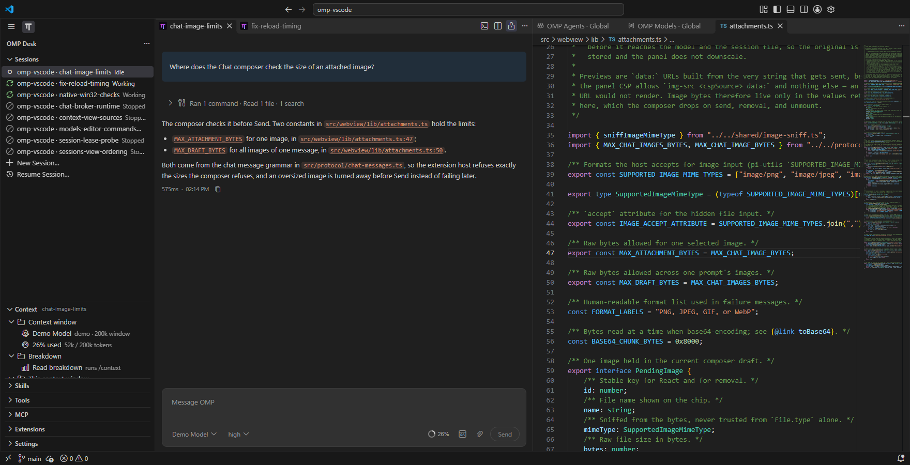
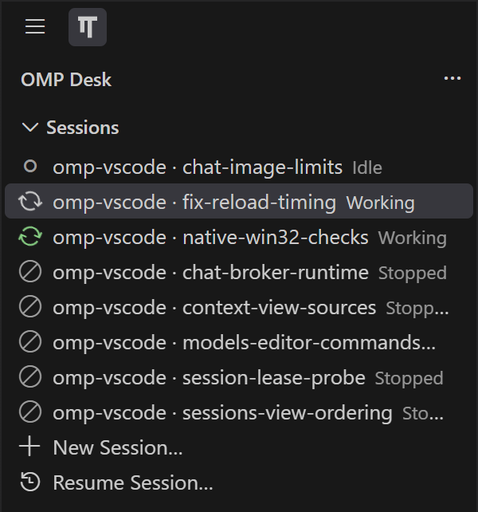
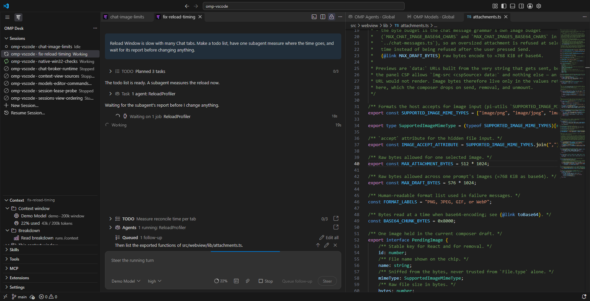
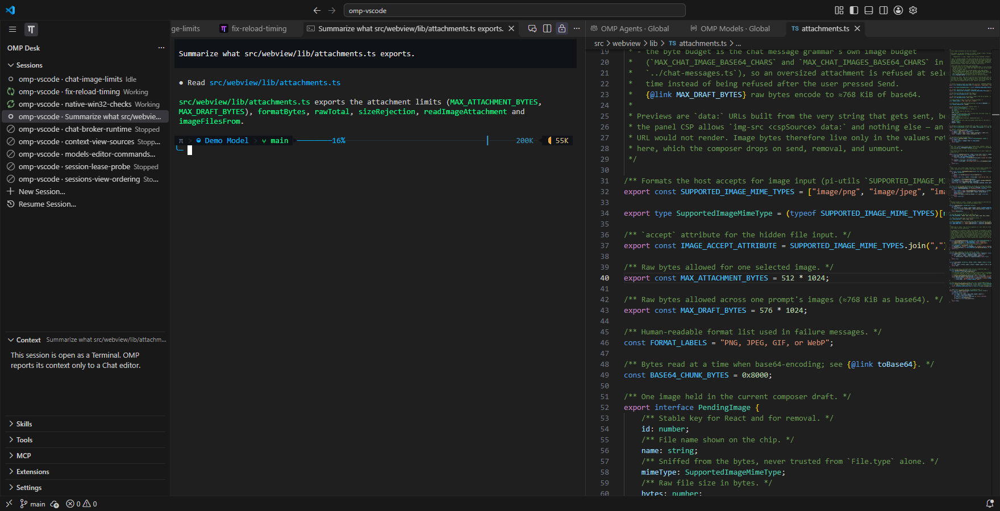

# OMP Desk

Run your [Oh My Pi](https://github.com/can1357/oh-my-pi) (`omp`) sessions from VS Code. OMP Desk lists every folder and conversation in one **Sessions** view. Each session opens in an editor tab as a rich **Chat** or as OMP's own native **Terminal** UI. Sessions keep running when you close the tab or reload the window.

> **Preview.** OMP Desk is an unofficial, independent integration, not an official OMP distribution. It is Windows-only.

## Requirements

- Windows 10 or 11, x64 or arm64.
- VS Code 1.110 or newer, in a trusted workspace.
- [Oh My Pi](https://github.com/can1357/oh-my-pi) installed, on your `PATH` and logged in to a provider. OMP Desk never bundles, installs or updates OMP; it runs the `omp` you already have. Either install form works: the Bun global install (`bun install -g @oh-my-pi/pi-coding-agent`, also what the `omp.sh` installer does when Bun is present) and OMP's own compiled program (winget `can1357.oh-my-pi`, the `omp.sh` binary install, mise). With the compiled program, host control (model readback, subagent work indicators, Terminal status) needs a build that accepts Bun's startup options from `BUN_OPTIONS`; Desk checks that once per executable and, when it does not, runs the session without host control and says so. Chat itself is unaffected.

## Getting started

1. Install **OMP Desk** (`hmmvot.omp-desk`) from the Extensions view. Or download the VSIX for your architecture from [releases](https://github.com/hmmvot/omp-desk/releases) and run `code --install-extension omp-desk-win32-x64-0.1.0.vsix` (or `omp-desk-win32-arm64-0.1.0.vsix`).
2. Open the **OMP Desk** view in the Activity Bar. The folders open in this window are already listed, with their existing OMP sessions.
3. Use a folder's **New Session** action. The session opens in an editor tab.
4. Close the tab whenever you like. The session keeps running until you stop it.

## Features

### Sessions that survive restarts

- Each session runs in its own background process.
- Close its tab, reload the window or close VS Code: the session keeps working.
- Reopen it to get the same process and screen back.
- **One exception: installing a VS Code update.** Its installer stops every `Code.exe` of the install after waiting about 30 s, and the session hosts run as `Code.exe` too, so **Restart to Update** ends the OMP processes of running sessions (a turn in progress and its sub-agents are lost). OMP Desk cannot prevent that; when it sees the updater's log naming one of its hosts, it says so, and it resumes the sessions that were running from their files.
- Only one window writes a session at a time.
- Stopping a session never deletes its history.

For how this works, see the [architecture](docs/architecture.md).

### Desktop notifications

- A Windows notification tells you when a session finishes or asks for input.
- None appears for the session you are already looking at.
- Click the notification to jump to the session.
- Turn them off with `ompDesk.desktopNotifications`.

### Chat or Terminal in one tab

- **Switch to Chat** and **Switch to Terminal** in the editor title change the view of the same session.
- New sessions open in Chat. Choose Terminal for all new sessions with **OMP Desk: Choose Default Session View…**.
- Prefer the OMP terminal? Use OMP Desk as a host for native OMP terminals that survive reloads.
- Sessions open in their own editor group on the left, and OMP Desk locks it. Files opened from Chat links, the Explorer or Quick Open go to a group on the right, so you read them next to the chat. Turn this off with `ompDesk.chatColumn`; unlock the group from its title bar for a one-off change.

### Sessions view

- Shows every OMP session, running or stopped, of the folders open in **any window** of the profile and the folders you pin, so every window shows the same list in the same order. By default it is **one flat list**, each row labelled `folder · title`; the layout button in the view's title bar opens a picker for the **flat list**, sessions **grouped under their folders** and the **Terminals** layout, which lists the background processes (`ompDesk.sessionsGrouping`). In the flat list and the folders layout, terminals and processes that no listed session stands for are in a **Terminals** group at the very end, after the New Session… and Resume Session… rows and set off by a blank row.
- The flat list puts sessions that are not stopped first, unread ones on top and then the most recently active, and stopped sessions last. A **New Session…** row and a **Resume Session…** row under it, at the end, ask for the folder; Resume Session asks for the folder when several are shown, then lists that folder's saved sessions. The title bar has no New Session or Resume Session button.
- A blue **●** at the right end of a row marks a reply you have not read: the agent finished or asked you something while you were not looking at that session. It clears when you look at the session's editor, and it survives a window reload.
- While a session has an open editor, its row stays selected: the one you viewed most recently. Selecting a folder or the New Session or Resume Session row puts the selection back. (The Terminals layout has no session rows and keeps your selection.)
- If the default OMP profile has no models yet, **Log in to a model provider to start** appears above the sessions.
- **Pin Folder** keeps a folder in every window. **Add Folder** picks and pins another one.
- Live status per session: **Working**, **Waiting for subagents**, **Needs your answer**, **Idle** or **Unread reply**.
- A session open in another window shows the same live status there, and clicking it takes you straight to that window with the session's tab selected, with no question first. If that window cannot be brought forward (for example it has an unsaved multi-root workspace), you are told why.
- A session that a plain `omp` in a terminal is writing shows **Open in another OMP process**. OMP Desk asks before opening it too.
- Row actions: **Open**, **Rename**, **Reload**, **Close**, **Forget** and **Delete**. A folder's **Resume Session** lists every saved session.
- **Open Terminal in Folder** starts a plain shell editor in that folder.
- **Copy Diagnostics** in the context menu copies paths and process details for bug reports.

### Chat

- Streaming replies, saved history, image attachments and `@file` mentions.
- While a turn runs, `Enter` steers it and `Alt+Enter` queues a follow-up. Queued messages can be edited, removed or sent now as steering. `Alt+↑` takes the newest one back into the draft.
- **Stop** (or `Esc`) puts messages that were still queued back into the draft instead of running them.
- `↑`/`↓` in an empty composer walk through your earlier prompts. `Ctrl+R` searches past prompts of every conversation.
- **Retry** (`F5` or `Alt+R`) re-runs a failed or aborted reply.
- Copy buttons on code blocks and on your own messages.
- Fenced `mermaid` blocks are drawn as diagrams in your theme's colours once the block is complete (flowcharts, sequence, class, state, ER, gantt, pie and the other mermaid types); until then, and when a diagram has an error, you see the code. **Diagram | Source** switches the view, Copy copies the source, and a wide diagram scales to the block and opens at full size on click. The diagram renderer is loaded only when a reply has one. A block too large for the transcript has **Open diagram in a tab**, which draws it in an editor tab of its own.
- `Ctrl+T` shows or hides all thinking. Tool calls have three display modes, which two keys move between: **collapsed** (every group closed), **groups** (every group open and every call in it one collapsed line such as `> Read src/a.ts`) and **all** (every call expanded). `Ctrl+Shift+O` switches collapsed ↔ groups, and from all it folds the calls back to groups. `Ctrl+O` switches collapsed ↔ all, and from groups it expands everything. A key press also resets the groups and calls you opened or closed by hand; after it you can open or close any group or call again, and a group that arrives later follows the current mode. Every Chat remembers the choices.
- **Compact…** and **Shake…** in the context popover ask for OMP's mode first (`snapcompact` and `elide` preselected); **Export as HTML** and **Share** are in the editor title menu. `Alt+click` the model or thinking chip to cycle it; `Ctrl+Shift+U` cycles thinking.
- Terminal-only slash commands such as `/hotkeys` are never sent to the model. Chat opens the VS Code equivalent or says where the command works.
- Status lines and warnings from OMP extensions appear around the composer; their informational notices are not shown.
- **Rewind** goes back to one of your prompts in place and puts it into the composer to edit and send again: `Esc` `Esc` in an empty composer or anywhere else on the Chat page (while no turn runs), **Rewind to here** on a prompt, `/rewind` or `/branch`, or **OMP Desk: Rewind Conversation…**. **Undo** returns to where you were, and a marker where the conversation split switches between your branches.
- Rewind never restores files; it lists the files changed after that point. A chat started by an older OMP Desk must be restarted before it can rewind.
- **`/clear`, `/new`, `/delete` and `/fresh` work in Chat.** `/clear` clears model conversation history and rotates provider state in place, keeping the session file, title and tab. Only confirmed clears collapse earlier messages behind an expandable **Context cleared · N messages dropped** divider; Rewind targets stop at that boundary. A known incomplete Desk clear keeps history visible and says to retry; native/unknown markerless boundaries say **Context reset**, without hiding history. Nothing is retried automatically. Observed busy/background work is refused; settled readback cannot prove foreground bash/eval idleness. This is not complete terminal `/clear` parity: retained runtime state and fail-closed restart/reattach differences are documented in [ADR-0059](docs/decisions/0059-clear-chat-in-place-through-a-desk-registered-omp-command.md). `/fresh` rotates provider state without removing local history, with durable acceptance before admission reopens. `/new` opens a same-folder replacement and stops the old session only if its observed RPC settled predicate still allows it; a failed stop retains the old editor and reports the partial outcome. `/delete` confirms deletion before starting a replacement. Clear requires the Desk command and supported OMP entry points.
- Slash commands suggest their arguments.
- **Commands** (the terminal-prompt icon in the composer toolbar) lists the slash commands with a search box, so you do not have to type `/`. Commands that open a VS Code surface come first and carry a window icon whose tooltip names it: Models, Agents and OMP Settings editors, the Rewind picker, mode pickers for Compact and Shake, a Save dialog for Export, confirmations for Share and Delete, and the Keyboard Shortcuts, Source Control, Skills and Tools, Log In to Provider and Log Out of Provider views; then every other command OMP runs from chat text, with its source (OMP, skill, prompt, extension). Picking a VS Code command opens it, a command that takes arguments is put in the message box as `/name ` for you to finish, and one without arguments is sent as a message; what you had typed is never touched. A command that cannot run now (no running session, or a turn is running and OMP runs the command only between turns) is greyed out with the reason. Terminal-only commands that have no VS Code equivalent are not listed.
- OMP's questions and approval requests appear as a card above the composer.
- File paths in replies and tool rows are links. A click opens the file at that line. A bare file name in a reply (`session-index.ts:849`, `session-index.ts(849)`, `index.ts`) is a link too when VS Code's file search finds exactly one file of that name in the session's folders (the file in the session's own folder wins; `files.exclude` and `search.exclude` are honoured; on Windows the case of the name does not matter): a click opens it at the line. A name that several files carry links to a list of those files (dotted underline, tooltip "N files"): a click lets you choose. Code symbols in a reply (`Session`, `SessionData.Cast()`, `Parse<T>`, `[Tracked]`) are links too when VS Code's language extensions (C# Dev Kit, TypeScript, and others) report exactly one definition of them in the session's folders: a click opens the definition, `Ctrl+Click` shows its file in the Explorer. A symbol with several definitions links to VS Code's symbol search for its name (dotted underline, tooltip "N definitions"): a click lets you choose. A symbol none is found for stays plain code. The language extension must have loaded the workspace (a TypeScript server starts when a TypeScript file is open); symbol searches are ranked and may be capped by the language server, so in a very large workspace a common name may be missed or, rarely, linked to one of several declarations.
- Web links in replies, tool output and the TODO and Agents tabs open in a VS Code editor tab on click or `Enter`, and in your browser on `Ctrl+Click` or `Ctrl+Enter`.
- Routine tool calls are grouped in an **Overview**. Set `ompDesk.toolCallDetail` to **detailed** to show every call as its own row, in every Chat. The setting decides whether calls are grouped; the tool display mode above decides only what is open. In Detailed there are no groups, so the groups mode looks like collapsed there (every call is already one line).
- Pinned rows show the TODO list and running subagents. Open a subagent's live transcript in its own tab.
- Model and thinking pickers work at any time, also during a turn. A change OMP cannot take yet (compaction, a rewind, a reconnect) waits, shown in the picker with a clock icon, and is sent as soon as OMP is ready, before your next message. The footer shows context usage, provider quotas and the Git branch.
- A status bar item shows the provider limits of the active Chat compactly, for example `5h 42% · 2h13m  │  7d 18% · 3d4h`: the used percent and the time left until each window resets (written like `4d4h42m`: days, hours and minutes, each only when above zero). It turns yellow from 80 % and red from 95 %, its tooltip has the exact reset times, and a click refreshes it. Right-click it to hide it.
- Without available models, the model chip offers **Log In to Provider**. Every model picker also ends with **Log In to Provider…** to add another provider: you pick the provider in VS Code, sign in in your browser and, where the provider asks for it, paste the authorization code into a masked box. Providers that take an API key are set up in a terminal (**Other providers** in the list, or run `omp` and use `/login`).
- Your draft stays until OMP confirms it. Nothing is resent automatically.
- If OMP stops responding, **Reconnect** or **Restart** the conversation.
- Follows your light, dark or high-contrast theme.

### Terminal

- The unmodified native OMP TUI, with Nerd Font glyphs, links and clickable file paths.
- Web links drawn by OMP open the same way as in Chat.
- **Copy screen** and **Redraw Terminal** (`Ctrl+Alt+Shift+R`) in the editor title menu.
- Theme changes recolor the terminal without restarting it.

### Send code to a session

- Select code and press `Alt+Shift+K`, or use **Add Selection to Session** or **Add File to Session** from the editor, Explorer or tab context menu.
- Pick the session. OMP Desk inserts an `@path` reference, with lines for a selection.
- It never sends the prompt for you.

### Processes, Stats and Tools

- **Background processes** are part of **Sessions**: a running session shows `Process: running` in its tooltip, and terminals and processes that no listed session stands for are in a **Terminals** group at the end of the list. The **Terminals** layout lists every process with its folder; a click opens its session or terminal, and **Stop** ends one. **Stop Orphaned and Idle** cleans up unused processes. **Kill All** stops everything in this window, and after you confirm, in all windows.
- **Stats** in the Sessions title opens OMP's usage dashboard in an editor tab. If your OMP build would also open a browser, OMP Desk asks first.
- **Tools** lists the tools of the session in the active session editor, and its skills in Chat.

## Commands and shortcuts

All commands are in the Command Palette under **OMP Desk**. The ones with default keys:

| Key | Command | When |
| --- | --- | --- |
| `Ctrl+Shift+L` | Focus the chat composer of the active or visible session; opens the OMP Desk side bar when no session is open | Anywhere, including the integrated terminal (takes over VS Code's Select All Occurrences of Find Match key; rebind it with a user keybinding) |
| `Ctrl+Alt+Q` | Go to Session: a searchable list of every session (title, folder, status; unread first, stopped last, as in Sessions) that opens the one you pick, with **New Session…** at the end | Anywhere, including the integrated terminal |
| `Ctrl+Shift+M` | Toggle the file window: the first press moves all files of the group next to the chat into one window that stays on top (files from Chat links open there too); the next press brings them back next to the chat and closes it | Anywhere, including the integrated terminal (replaces VS Code's Problems key; a keymap extension that binds it in text editors wins there unless you add a user keybinding) |
| `Ctrl+Enter` | Send composer prompt (`Enter` in the composer also sends) | Chat editor focused |
| `Esc` | Stop current turn | Chat editor, turn running |
| `F5`, `Alt+R` | Retry the failed or aborted reply | Chat editor, no turn running |
| `Ctrl+R` | Search prompt history | Chat editor |
| `Ctrl+N` | Symbol search (`#`) prefilled with the Chat selection | Chat editor |
| `Ctrl+Shift+N` | Go to File prefilled with the Chat selection | Chat editor |
| `Ctrl+T` / `Ctrl+O` / `Ctrl+Shift+O` | Show/hide all thinking / expand/collapse all tool calls / open or close the tool groups with every call collapsed | Chat editor |
| `Ctrl+Shift+U` | Cycle thinking level (**Cycle Model** has no default key) | Chat editor |
| `Ctrl+Alt+Shift+R` | Redraw Terminal | Terminal editor |
| `Alt+Shift+K` | Add Selection to Session | Text editor with a selection |

A keymap extension (the IntelliJ IDEA keymap, for one) that binds `Ctrl+N` or `Ctrl+Shift+N` in text editors can win over these two keys, because VS Code does not let an extension choose its place in the keybinding order. Add a user keybinding (**Preferences: Open Keyboard Shortcuts (JSON)**) with the same `when` clause: `{ "key": "ctrl+n", "command": "ompDesk.searchSymbolFromChat", "when": "activeWebviewPanelId =~ /^omp[.]session/ && ompDesk.sessionMode == chat" }`, and the same for `ctrl+shift+n` with `ompDesk.searchFileFromChat`.

`Ctrl+Shift+O` is VS Code's Go to Symbol in Editor, which does nothing in a Chat (it has no text editor); OMP Desk takes it there only, under the same `when` clause. It is free in the IntelliJ IDEA keymap (that keymap puts Go to Symbol on `Ctrl+Alt+Shift+N`). If another extension binds it in a way that wins, or you want another key, add a user keybinding the same way: `{ "key": "alt+o", "command": "ompDesk.toggleToolGroups", "when": "activeWebviewPanelId =~ /^omp[.]session/ && ompDesk.sessionMode == chat" }`.

Other commands include **New Session**, **Add Folder**, **Pin Folder**, **Unpin Folder**, **Resume Session**, **Switch to Chat / Terminal**, **Compact Conversation…**, **Shake Conversation…**, **Export Conversation as HTML…**, **Share Conversation Link…**, **Show Chat Keyboard Shortcuts**, **Open Stats**, **Log In to Provider…**, **Log Out of Provider…**, **Show Diagnostics** and the file-change observation commands.

## Settings

| Setting | Default | Meaning |
| --- | --- | --- |
| `ompDesk.toolCallDetail` | `overview` | `overview` groups routine tool calls; `detailed` shows each call. Applies to every Chat. |
| `ompDesk.desktopNotifications` | `true` | Windows desktop notifications when a session finishes or asks for input. |
| `ompDesk.showWorkspaceFolders` | `true` | Show the folders VS Code has open in this window in Sessions. When off, only pinned folders (and folders with a running session) are listed. |
| `ompDesk.runSessionsAtRepositoryRoot` | `true` | Run sessions at the root of the version-control checkout the opened folder lies in, and use that folder for **OMP Settings**, Models and Agents project settings (`<root>/.omp`), so a Unity project opened as `<repo>/omp-vscode` runs its sessions, and saves its project settings, at `<repo>`. Git (also worktrees and submodules), Mercurial, Sapling, Jujutsu, Subversion, Plastic SCM / Unity Version Control, Bazaar, Fossil, Pijul, Darcs, CVS and Perforce (a `P4CONFIG` file) are recognised by their marker (`.git`, `.hg`, `.sl`, `.jj`, `.svn`, `.plastic`, `.bzr`, `.fslckout`, `.pijul`, `_darcs`, `CVS/Root`, `.p4config`); the nearest one wins, and your home folder or a drive root is used only when it really is a checkout. A folder in no checkout runs where it is. Turn it off for a folder (or workspace) of a monorepo to run sessions in that folder itself. Sessions already recorded keep the folder they ran in. Replaces `ompDesk.useAgentRootFolder` and `ompDesk.ompSettings.useNearestAncestorOmpFolder`: an explicit `false` of the first is carried over at the next start, the second is dropped. |
| `ompDesk.launchInFolderWindow` | `true` | Start a session in the window that has its folder open: New Session, Resume Session and opening a stopped session of a folder that is open only in another window run there, and that window comes to the front. A Unity project (a folder with `ProjectSettings/ProjectVersion.txt` and `Assets/`, found in the folder or two levels below it) always runs in a window that has the project folder open, or in a new window opened on it, because the Unity extensions need it; the session's working directory stays the repository folder. If that window does not answer, a message says so and nothing starts. When off, a session starts in the window you used. |
| `ompDesk.sessionsGrouping` | `flat` | `flat` shows one list of every session, labelled with its folder; `folders` groups sessions under their folders; `terminals` lists the background processes (session processes and terminals) instead. The layout button in the Sessions title bar (its icon shows the current layout) opens a picker that changes it. |
| `ompDesk.linkCodeSymbols` | `true` | Link inline code symbols in Chat replies (`Session`, `SessionData.Cast()`, `[Tracked]`) to their definition when VS Code's language extensions report exactly one definition of the symbol in the session's folders. A partial class or overloads link to one of their declarations; a symbol with several different definitions links to the symbol search; unknown symbols stay plain code. The same setting turns on linking a bare file name (`session-index.ts:849`) to the file VS Code's file search finds in the session's folders; several files of that name link to a list to choose from. |
| `ompDesk.linkReminder` | `false` | After every prompt you send, remind the model to write the files and folders it mentions as paths in inline code and every code symbol in its Chat replies as a link with its definition line. The reminder (about 120 tokens) is a separate message that goes to the model only; it is never saved to the session or shown, and your prompt is not changed. Applies to sessions started or resumed afterwards. |
| `ompDesk.chatColumn` | `true` | Open sessions in their own locked editor group on the left, with files on the right. When off, a session opens in the active editor group. |
| `ompDesk.executablePath` | empty | Absolute path of the OMP to run: the `omp` program itself, or a Bun-installed `omp.exe`. Empty uses the first `omp` on PATH. When set it is the only OMP Desk considers: if it cannot be used, Desk says why and does not search PATH. User settings only (a workspace cannot set it); applies to sessions started, resumed or read afterwards. The Settings view's row for it has a **Test** button that resolves the typed path without saving it. |

**Models** and **Agents** (`/models`, `/agents`, or the Command Palette) list every role and agent with the model it runs on, its thinking level and where that comes from (environment, project, global, a role it follows, OMP's built-in list, an override or its definition). Select one to see how it was decided, who depends on it and, for an agent, what resetting its override would change. A provider that needs login has a **Sign in** button, and agent overrides can be saved to the project config as well as the global one.

**OMP's own settings** open in **OMP Desk: Open OMP Settings** (also `/settings` in a Chat and the first entry of the Sessions title menu), laid out like VS Code's Settings editor: OMP's own tabs, groups, labels and controls, search with filters (`@modified`, `@env`, `@warning`), and a **Global / Project / Effective** switch. Each change is written to the **global** or the **project** (`.omp/config.yml`) layer, with the layer each value comes from, an environment override named when one applies, and **Reset** to remove a layer's value. Credentials are never shown (set them with `omp config set` in a terminal); lists and mappings open their YAML at the key. It needs Bun and the installed OMP's source files; an OMP whose settings schema it does not recognise is refused without changing anything. OMP's models, tools, skills and MCP servers live in OMP's files; the Models and Agents editors and the Skills, Tools, MCP and Extensions views cover them.

### Upgrading from 0.3.x

Every command, setting, view and context key moved from `omp.` to `ompDesk.` (OMP Desk no longer uses the namespace of Oh My Pi itself), and the Command Palette category is **OMP Desk**.

- **Settings** move to their `ompDesk.` names by themselves the first time this version starts, in your user settings and in a workspace's settings where the setting can live there; the output channel **OMP Desk** has one line per moved setting. A value that cannot be moved (a read-only workspace settings file) stays where it is, and the line says why.
- **Keybindings** in your own `keybindings.json` keep working for now: the old command ids are still accepted, and the first use of each shows a warning with a button that opens the file. Rename `omp.<command>` to `ompDesk.<command>` there, in `when` clauses too (`omp.sessionMode`, `omp.streaming`, `omp.composerPopupOpen` are also still set under their old names); entries that remove a default binding (`-omp.<command>`) must be renamed at once, because they cannot be forwarded. The old ids keep working until 1.0.0, which removes them.
- The OMP Desk views return to their default arrangement once (collapsed state, order, the side bar they were moved to).

## Limitations

- Windows only. There are no macOS or Linux builds.
- Stopping a folder shell cannot guarantee that every child process stopped. Commands detached from the shell may keep running.
- OAuth-dependent MCP setup, and anything OMP asks you to do in its own settings UI, is done in OMP.
- Installing OMP and switching OMP versions are outside the extension.

## Privacy and security

Everything runs on your machine. OMP Desk talks to your local `omp` over authenticated local pipes, keeps its metadata in VS Code's global storage and sends no telemetry. Notification text contains the session title, the folder name and a short reason or question; Windows may keep it in notification history. Please report vulnerabilities privately; see [SECURITY.md](SECURITY.md).

## Troubleshooting

- **OMP not found.** Make sure `omp --version` works in a new terminal, then reload the window.
- **Something looks wrong.** Open **View > Output** and choose **OMP Desk**, and run **OMP Desk: Show Diagnostics**. Include both when you [report a bug](https://github.com/hmmvot/omp-desk/issues/new/choose).
- **Upgrading from an early local build.** See [Moving from the unpublished local build](docs/publishing.md#moving-from-the-unpublished-local-build).

## Documentation and contributing

Design documents, architecture decision records and the current architecture are in [docs](docs/README.md). Contributions are welcome: see [CONTRIBUTING.md](CONTRIBUTING.md), and [CHANGELOG.md](CHANGELOG.md) for what changed.

## How this was made

OMP Desk is 100% vibe coded. All of its code, tests and documentation were written by AI agents running in [Oh My Pi](https://github.com/can1357/oh-my-pi); none of it was written by hand. Agents also reviewed the designs and code, and ran the automated tests. Expect rough edges, and please [report them](https://github.com/hmmvot/omp-desk/issues/new/choose).

## License and credits

OMP Desk is released under the [MIT License](LICENSE). It uses and adapts open-source work, listed with its licenses in [THIRD_PARTY_NOTICES.txt](THIRD_PARTY_NOTICES.txt): [oh-my-pi](https://github.com/can1357/oh-my-pi) (MIT, including the adapted icon artwork), [Paseo](https://github.com/getpaseo/paseo) (Apache-2.0, text reveal policy), [xterm.js](https://github.com/xtermjs/xterm.js) and [node-pty](https://github.com/microsoft/node-pty) (MIT), React (MIT) and the VS Code [Codicons](https://github.com/microsoft/vscode-codicons) (CC-BY-4.0).
