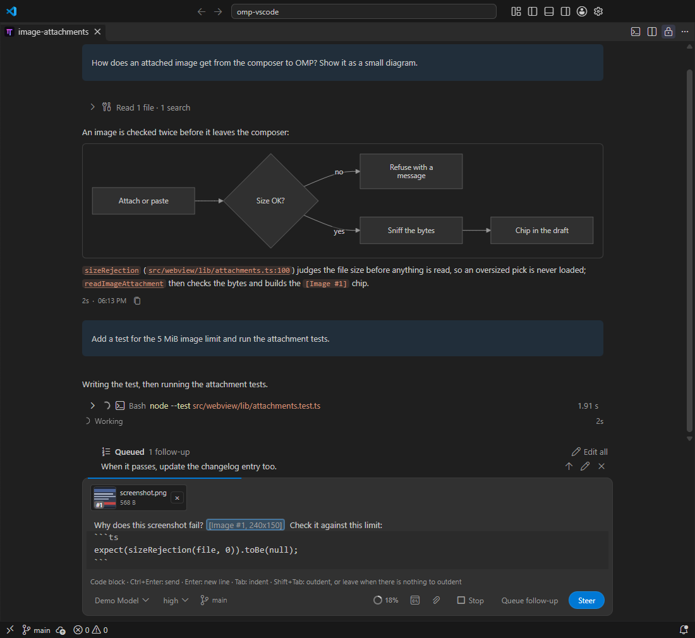

# Chat

Chat is the rich editor view of a session. It opens in an editor tab, shows the conversation as it streams, and follows your light, dark or high-contrast theme. The same tab can be switched to OMP's native [Terminal](terminal.md) at any time. New sessions open in Chat.



## Writing and sending

- Streaming replies, saved history, image and document attachments and `@file` mentions.
- **Attachments:** the paperclip button opens a file dialog, and you can paste a file or hold Shift and drag one in, from the operating system or from VS Code's Explorer or an editor tab. An image (PNG, JPEG, GIF or WebP) is up to 5 MiB each and 10 MiB per message. Any other file that is text (UTF-8, no control characters, an empty file too) is a **document**: its whole text goes into your message. There is no limit on how many files you attach; one message carries at most 200 000 characters in all, and the composer says which file would take it over.
- Your draft stays until OMP confirms it. Nothing is resent automatically.
- `↑`/`↓` in an empty composer walk through your earlier prompts. `Ctrl+R` searches past prompts of every conversation.
- Copy buttons on code blocks and on your own messages.
- **Your messages show what you typed.** `_`, `*` and `~~` in a message you send stay as written (`obj._method() ..... obj._otherMethod()` and `1*234*343` are never turned into italic, bold or strikethrough). Code spans and fences, `> ` quotes, lists, tables, links and `[Image #1]` references still render. Replies and thinking keep full Markdown styling.
- **Retry** (`F5` or `Alt+R`) re-runs a failed or aborted reply.
- If OMP stops responding, **Reconnect** or **Restart** the conversation.

### Steer and queue while a turn runs

- While a turn runs, `Enter` steers it and `Alt+Enter` queues a follow-up.
- Queued messages can be edited, removed or sent now as steering. `Alt+↑` takes the newest one back into the draft.
- **Stop** (or `Esc`) puts messages that were still queued back into the draft instead of running them.
- OMP's questions and approval requests appear as a card above the composer.

### Code blocks in the draft

Type a line of three backticks, with a language if you like (`` ```ts ``), and press `Enter`: the composer adds the closing fence and puts the caret between the two. From the opening fence to the closing fence (or to the end of the draft while there is none) the composer works like a small editor:

- `Enter` is a new line that keeps the line's indentation and does not send.
- `Tab` indents (four spaces; on several selected lines it indents them all) and does not move the focus. `Shift+Tab` outdents.
- **`Ctrl+Enter` sends from inside a block** (a follow-up while a turn runs: `Ctrl+Alt+Enter`). `Enter` and `Tab` behave as before outside a block.
- Only the block is set in your editor's font, on a band that marks its rows; the prose around it keeps the proportional font. The text is the same: plain Markdown, fences included, and nothing completes inside a block: no `/` commands, no `@` files.
- A line under the composer lists these keys while the caret is in a block.
- **Keyboard way out:** `Shift+Tab` on a line with nothing left to outdent moves the focus to the previous control; `Ctrl+Shift+L` brings it back.

### Quoting Chat text

Select text in an assistant reply, one of your own messages or an open thinking block and quote it into the draft; write your comment right under it and send one message with several quotes.

- **How:** select the text, then press `Alt+Q` or right-click the selection and choose **Quote Selection** (also **OMP Desk: Quote Selection** in the Command Palette). There are no Quote buttons. A selection has to be started with the mouse; once it exists, `Shift+Arrow` extends it.
- **What lands in the draft:** the Markdown source of exactly what you selected, as `> ` lines at the end of the draft, after a blank line. A link, a code span, emphasis, a list marker or a code fence comes along when the selection covers it; a partly selected code block is wrapped in a fence again, with its language. Tool output and notices are never quoted. The caret is on the line directly under the quote. A selection inside your own message is quoted character for character, since its `_`, `*` and `~~` are shown as typed.
- **Tables:** a selection inside one cell quotes just that text, like a paragraph (a bold run you selected whole stays `**bold**`; a part of it is plain text), with no header and no `|`. A selection across several cells or rows quotes a table: the header, the separator and the rows you touched, only in the columns between the first and the last cell you selected, with those two cells cut to your selection. A selection that starts before the table or ends after it quotes the rows it reaches whole, with every column.
- **Edit a quote like any text:** a quote is plain `> ` lines shown on a band with a bar, and its keys are the code block's. `Enter` is a new line that carries the `> ` (`Shift+Enter` and `Alt+Enter` do the same), and `Enter` again on the empty quote line lets go of it. `Shift+Tab` leaves the quote at once: it adds a plain line under the current one and puts the caret there (a nested `> > ` quote leaves one level per press). `Ctrl+Enter` sends from inside a quote (a follow-up while a turn runs: `Ctrl+Alt+Enter`). `Backspace` at the start of a line removes one level. Text with several lines that you paste or drop on a quote line stays in the quote. The **✕** beside a quote removes the whole quote in one undo step and keeps the comment under it, and `Ctrl+Z` brings it back. A line under the composer lists these keys while the caret is in a quote.
- **Limits:** a quote takes at most 20 000 characters of Markdown, and the draft at most what OMP Desk can send; the line under the composer says why a quote was refused. If part of a selection cannot be mapped back to its source, that part is quoted as the text you saw and the line says "as plain text".
- **What the model sees:** the `> ` lines and your comment, as typed. Your sent message shows the quote and the comment under it.
- **From a text editor:** select text in any text editor and press `Alt+Q`, or right-click the selection and choose **Quote Selection to Session** (also in the Command Palette). Pick the Chat session in the list, as for [Add Selection to Session](send-code.md); only Chat sessions are offered, and **New session** starts a Chat. The quote lands in that session's draft the way a Chat quote does, with the caret under it, and is never sent. Its first line is the file and the lines as inline code (`src/app.ts:42-50`, relative to the session's folder when the file is inside it, else the full path; no `@`, so OMP does not read the whole file), then the text: a code file in a fenced block with its language, a Markdown or plain-text file as plain quote lines. Each selection of a multi-cursor selection is its own quote. An untitled document is quoted without a location. The limits are a Chat quote's: 20 000 characters in all, refused with the size; the file's location is the saved file's even when the editor has unsaved changes.
- **No list when a Chat is in view:** if a Chat session of this window is visible (its tab is in front in any editor group, for example a Chat in the left group and the file in the right one), `Alt+Q` quotes straight into that Chat's composer and moves the focus there; nothing is asked. With several visible Chats the one you focused last is used. A Chat hidden behind another tab, a Terminal session and a stopped Chat do not count; when none is visible, the list above appears. [Add Selection to Session](send-code.md) always asks.

### Editing the draft

- `Ctrl+Z` undoes and `Ctrl+Y` or `Ctrl+Shift+Z` redoes, including a pasted image and its reference. VS Code's **Edit > Undo** menu item does not act on the composer: use the keys.
- A paste inserts plain text only, whatever the page it came from. Text you drag onto the composer lands where you drop it.
- A `[Image #N]` or `[File #N: name]` reference is one unit: the caret hops over it and one `Backspace` removes it with its attachment.

### Attaching documents

- **Each file is a chip in the draft and a tile under it** (an icon chosen by the file's extension, `#N`, its name and size, a **✕**). The tile shows no file text. `Ctrl+Z` brings a removed file back. Attaching the same file twice gives two chips. A file that is not text (a PDF, a binary, an image format OMP cannot take) is refused by name and attaches nothing.
- **What is sent.** Your text first, then each file's whole text in a block after it (`<file path="docs/notes.md" n="1" chars="…">`; a file with no path, pasted or restored, has a `name` instead). A file that came by path, from the dialog or a drag from VS Code, is read from disk when you press Send, so the model sees the file as it is then; if it was deleted, turned into a binary, or no longer fits the message, nothing is sent and your draft stays. If an open editor holds unsaved changes to it, a line tells you the saved text was sent. A pasted file is sent as it was when you pasted it. This works the same for a message, a steer and a queued follow-up.
- **The model reads the text, not instructions in it.** OMP acts on `@path` mentions, `^model`, `+N` turn budgets and `/skill:name` tokens in a message. In an attached file's text, Desk puts an invisible zero-width space (U+200B) before each of them as it sends, so a file that happens to contain `@src/a.ts` or `/skill:x` is never read as an instruction; the model receives the file's own text. The text you type yourself is not changed, and the invisible characters are removed when Desk shows the file, copies it or puts it back in your draft. A file that already contains U+200B is restored exactly.
- **In the conversation** each file is one closed row under your message (name, line count and size); open it to read the highlighted text, and **Copy** takes the file's own text. The rows are drawn again from the saved history after a reload.
- **Getting them back.** Rewind, **Edit** on a queued message, `↑`/`↓` through earlier prompts and a draft carried to a replacement editor put the files back as chips with the text that was sent. `Ctrl+R` remembers a message with each file reduced to its path and no text, and a recalled message attaches those files again from disk; one with no path, or one that has since been deleted, is named in a line and has to be attached again.
- **Dragging a file in: hold Shift.** VS Code, not OMP Desk, decides who receives a file dragged over a Chat. Without Shift, VS Code takes the drag as soon as the pointer has crossed another part of its window (the tab bar, the side bar, the title bar), shows its own drop overlay and opens the file in an editor, and the Chat never sees it; it reaches the Chat only when the drag happens to enter straight over the Chat, which is why an unshifted drop works sometimes and not other times. With **Shift** held over the Chat (press it before you let go; it applies to drags from the file manager and from VS Code's Explorer alike) the drop always reaches the Chat. The Attach button and a paste never depend on this. If VS Code has opened a file instead, drop it again with Shift held, or use the Attach button.
- **If VS Code opened the file, or the Chat ignores your drag.** A drop VS Code took leaves the Chat refusing plain drags until the mouse moves over the VS Code window again (measured: a mouse move, a click in the Chat or on its tab, or a Shift drag over the Chat lifts it at once; **Esc**, hiding and showing the Chat tab with the keyboard, and a simulated focus change do not). So: close the file VS Code opened, move the mouse over the Chat, and drag again with **Shift** held, or use the Attach button, which never depends on any of this.
- **A file that is too large** (a log of several megabytes, for example) is refused by name with its size and the 200 000-character limit; the composer stays ready, and the next drop or attach works as usual.
- **Fallback route.** When the page talks to the extension over the fallback connection (a rare, slow route), the file dialog and drops from VS Code are not offered, and a message too large for that connection is refused with a sentence instead of being sent.

## Reading replies

### Tool calls, thinking and the Overview

- `Ctrl+T` shows or hides all thinking.
- Tool calls have three display modes, which two keys move between: **collapsed** (every group closed), **groups** (every group open and every call in it one collapsed line such as `> Read src/a.ts`) and **all** (every call expanded).
  - `Ctrl+Shift+O` switches collapsed ↔ groups, and from all it folds the calls back to groups.
  - `Ctrl+O` switches collapsed ↔ all, and from groups it expands everything.
  - A key press also resets the groups and calls you opened or closed by hand; after it you can open or close any group or call again, and a group that arrives later follows the current mode. Every Chat remembers the choices.
- Routine tool calls are grouped in an **Overview**. Set [`ompDesk.toolCallDetail`](settings.md) to **detailed** to show every call as its own row, in every Chat. The setting decides whether calls are grouped; the tool display mode above decides only what is open. In Detailed there are no groups, so the groups mode looks like collapsed there (every call is already one line).
- Pinned rows show the TODO list and running subagents. Open a subagent's live transcript in its own tab.
- Status lines and warnings from OMP extensions appear around the composer; their informational notices are not shown.


### Finding text in the conversation

`Ctrl+F` anywhere in a Chat (the composer included, which has no find of its own) opens a find bar in the corner of the transcript. **OMP Desk: Find in Chat** (the Command Palette and the editor's `…` menu) opens the same bar, and you can give that command a key of your own.

- **It searches the conversation, not just the rows in the page.** A long conversation keeps only the rows on screen in the page, which is all VS Code's own find could see, so the bar reads the loaded conversation itself: your messages, the replies and their thinking, and each tool call's name, target, intent and output text. It does not search notices and summaries, the text of attached files, the history before a context reset (`/clear`), or messages still on disk behind **load earlier messages**; the bar says how many of those there are.
- **It starts at the newest match.** `Enter` or `F3` goes to the next match and `Shift+Enter` or `Shift+F3` to the previous one, both wrapping round; the bar shows `3 of 12` (or `No results`). `Alt+C` turns **Match Case** on and off. The query is literal text, not a pattern. Text you had selected in the Chat fills the field.
- **The match is shown.** The row is loaded into the transcript if it was above the rows the Chat keeps, scrolled to (deep inside a long reply, to the line), and what hides it is opened: a tool group, the call's output or a thinking block. They stay open when you move on. Every match in the rows on screen is highlighted and the current one stands out. In a long tool output only the rows the card shows are highlighted (the match's row is outlined); use **Show all** and the output's own **Filter lines** to look further.
- **`Esc` closes the bar** and puts the focus back where it was, the composer if that is gone. While the bar's field has the focus `Esc` does not stop a running turn.
- With screen-reader paging on, the page that holds the match is shown. `Ctrl+F` is taken by the Chat page itself, so it also works in a view-only Chat and while the extension restarts; it is not in **Show Chat Keyboard Shortcuts**, because it is not a VS Code keybinding.

### Mermaid diagrams

Fenced `mermaid` blocks are drawn as diagrams in your theme's colours once the block is complete (flowcharts, sequence, class, state, ER, gantt, pie and the other mermaid types); until then, and when a diagram has an error, you see the code.

- **Diagram | Source** switches the view, Copy copies the source, and a wide diagram scales to the block and opens at full size on click.
- The diagram renderer is loaded only when a reply has one.
- A block too large for the transcript has **Open diagram in a tab**, which draws it in an editor tab of its own.

### Links to files, code symbols and the web

- File paths in replies and tool rows are links. A click opens the file at that line.
- A bare file name in a reply (`session-index.ts:849`, `session-index.ts(849)`, `index.ts`) is a link too when VS Code's file search finds exactly one file of that name in the session's folders (the file in the session's own folder wins; `files.exclude` and `search.exclude` are honoured; on Windows the case of the name does not matter): a click opens it at the line. A name that several files carry links to a list of those files (dotted underline, tooltip "N files"): a click lets you choose.
- Code symbols in a reply (`Session`, `SessionData.Load()`, `Parse<T>`, `[Tracked]`) are links too when VS Code's language extensions (C# Dev Kit, TypeScript, and others) report exactly one definition of them in the session's folders: a click opens the definition, `Ctrl+Click` shows its file in the Explorer. Namespaces written before the type are ignored when the language extension does not report them (`OmpDesk.Core.SessionData.Load`), and a member the type inherits from a base class links to the base class's declaration when the language extension offers a type hierarchy (C# does). A symbol with several definitions links to VS Code's symbol search for its name (dotted underline, tooltip "N definitions"): a click lets you choose. A symbol none is found for stays plain code.
- The language extension must have loaded the workspace (a TypeScript server starts when a TypeScript file is open). Symbol searches are ranked and may be capped by the language server, so in a very large workspace a common name may be missed or, rarely, linked to one of several declarations.
- Turn the symbol and bare-file-name links off with [`ompDesk.linkCodeSymbols`](settings.md); [`ompDesk.linkReminder`](settings.md) asks the model to write them as links itself.
- `Ctrl+N` (symbol search) and `Ctrl+Shift+N` (Go to File) are prefilled with the Chat selection; see [Keyboard shortcuts](keyboard-shortcuts.md). A selected qualified name such as `SessionData.Load` is looked up the way a link is: one definition opens at once, several are listed to choose from, and when none is found the symbol search opens for the name after the last dot.
- Web links in replies, tool output and the TODO and Agents tabs open in a VS Code editor tab on click or `Enter`, and in your browser on `Ctrl+Click` or `Ctrl+Enter`.
- **OMP's internal addresses** in a reply are links when this session has what they name: `agent://<id>` (a nested agent is `Parent.Child`) opens the agent's read-only transcript tab while the live session knows it, and otherwise its published output `<id>.md` as a read-only document; `history://<id>` opens the transcript tab; `artifact://<n>` opens a tool result's full output; `local://<path>` opens a file of the session's scratch space. `Ctrl+Shift+Click` shows the file behind a link in File Explorer. An address this session does not have stays plain text. `skill://`, `memory://`, `rule://`, `omp://`, `pr://` and `issue://` are never links, because only OMP can resolve them.
- **Commit hashes** in a reply are links when a commit with that hash exists in the repository of the session's folder: an inline code span such as `` `c7398070` `` (7 to 40 hex digits), or a hash with both digits and letters in the text. Click it (or `Enter`) to open Source Control with the commit shown: with GitLens installed the commit is selected in its **Commits** view when it is on the current branch, and shown in its Search & Compare view when it is on another branch (the Commits view lists the current branch only); without GitLens the commit's changes open in one editor. A hash that matches no commit, or an abbreviation that several commits share, stays plain text. Only the assistant's replies are linked.

## Rewind

**Rewind** goes back to one of your prompts in place and puts it into the composer to edit and send again:

- `Esc` `Esc` in an empty composer or anywhere else on the Chat page (while no turn runs), **Rewind to here** on a prompt, `/rewind` or `/branch`, or **OMP Desk: Rewind Conversation…**.
- **Undo** returns to where you were, and a marker where the conversation split switches between your branches.
- Rewind never restores files; it lists the files changed after that point.
- A chat started by an older OMP Desk must be restarted before it can rewind.

## Slash commands

- Terminal-only slash commands such as `/hotkeys` are never sent to the model. Chat opens the VS Code equivalent or says where the command works.
- Slash commands suggest their arguments.
- `/models`, `/agents` and `/settings` open OMP's own editors; see [OMP settings, models and agents](omp-settings.md).

### The Commands list

**Commands** (the terminal-prompt icon in the composer toolbar) lists the slash commands with a search box, so you do not have to type `/`.

- Commands that open a VS Code surface come first and carry a window icon whose tooltip names it: Models, Agents and OMP Settings editors, the Rewind picker, mode pickers for Compact and Shake, a Save dialog for Export, confirmations for Share and Delete, and the Keyboard Shortcuts, Source Control, Skills and Tools, Log In to Provider and Log Out of Provider views.
- Then every other command OMP runs from chat text, with its source (OMP, skill, prompt, extension).
- Picking a VS Code command opens it, a command that takes arguments is put in the message box as `/name ` for you to finish, and one without arguments is sent as a message; what you had typed is never touched.
- A command that cannot run now (no running session, or a turn is running and OMP runs the command only between turns) is greyed out with the reason.
- Terminal-only commands that have no VS Code equivalent are not listed.

### `/clear`, `/new`, `/delete` and `/fresh`

These work in Chat.

- `/clear` clears model conversation history and rotates provider state in place, keeping the session file, title and tab.
- Only confirmed clears collapse earlier messages behind an expandable **Context cleared · N messages dropped** divider; Rewind targets stop at that boundary. A known incomplete Desk clear keeps history visible and says to retry; native/unknown markerless boundaries say **Context reset**, without hiding history. Nothing is retried automatically.
- Observed busy/background work is refused; settled readback cannot prove foreground bash/eval idleness.
- This is not complete terminal `/clear` parity: retained runtime state and fail-closed restart/reattach differences are documented in [ADR-0059](../decisions/0059-clear-chat-in-place-through-a-desk-registered-omp-command.md).
- `/fresh` rotates provider state without removing local history, with durable acceptance before admission reopens.
- `/new` opens a same-folder replacement and stops the old session only if its observed RPC settled predicate still allows it; a failed stop retains the old editor and reports the partial outcome.
- `/delete` confirms deletion before starting a replacement.
- Clear requires the Desk command and supported OMP entry points.

## Model, thinking, context and quotas

- Model and thinking pickers work at any time, also during a turn. A change OMP cannot take yet (compaction, a rewind, a reconnect) waits, shown in the picker with a clock icon, and is sent as soon as OMP is ready, before your next message.
- `Alt+click` the model or thinking chip to cycle it; `Ctrl+Shift+U` cycles thinking.
- The footer shows context usage, provider quotas and the Git branch.
- **Compact…** and **Shake…** in the context popover ask for OMP's mode first (`snapcompact` and `elide` preselected); **Export as HTML** and **Share** are in the editor title menu.
- A status bar item shows the provider limits of the active Chat compactly, for example `5h 42% · 2h13m  │  7d 18% · 3d4h`: the used percent and the time left until each window resets (written like `4d4h42m`: days, hours and minutes, each only when above zero). It turns yellow from 80 % and red from 95 %, its tooltip has the exact reset times, and a click refreshes it. Right-click it to hide it.
- Without available models, the model chip offers **Log In to Provider**; see [Log in to a provider](omp-settings.md#log-in-to-a-provider).
- The **Context** view in the OMP Desk side bar shows what fills the active Chat's context window; see [OMP settings, models and agents](omp-settings.md#views-for-skills-tools-mcp-extensions-and-context).
