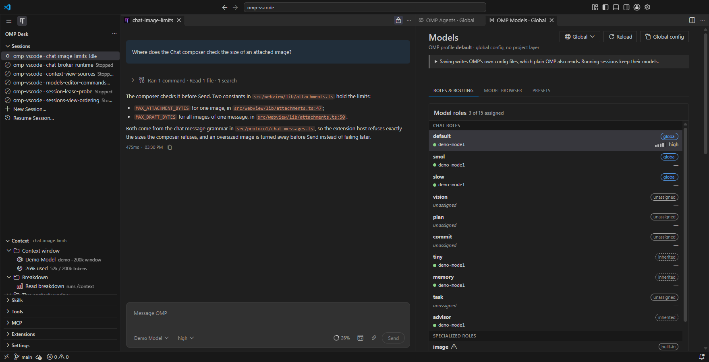
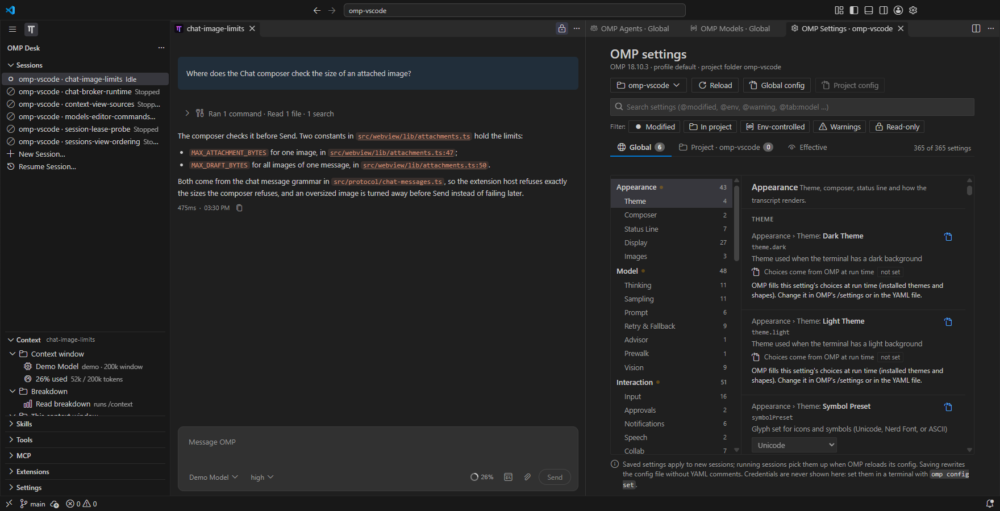

# OMP settings, models and agents

OMP Desk gives OMP's own configuration a VS Code interface. Models, Agents and OMP's settings open as editors; skills, tools, MCP servers, extensions and the context of a session are views in the OMP Desk side bar; providers are signed in from VS Code.

## Models and Agents

**Models** and **Agents** (`/models`, `/agents`, or the Command Palette: **OMP Desk: Open Models Settings**, **OMP Desk: Open Agents Settings**) list every role and agent with the model it runs on, its thinking level and where that comes from (environment, project, global, a role it follows, OMP's built-in list, an override or its definition).

- Select one to see how it was decided, who depends on it and, for an agent, what resetting its override would change.
- A provider that needs login has a **Sign in** button.
- Agent overrides can be saved to the project config as well as the global one.
- Like OMP Settings, they need Bun and the installed OMP's source files. With OMP's standalone program there are none to read: the editor does not open, the Chat or the notification says why, and `/agents` or `/model` in the session's Terminal view is the way to do the same.

## OMP Settings

**OMP's own settings** open in **OMP Desk: Open OMP Settings** (also `/settings` in a Chat and the first entry of the Sessions title menu), laid out like VS Code's Settings editor.

- OMP's own tabs, groups, labels and controls, search with filters (`@modified`, `@env`, `@warning`), and a **Global / Project / Effective** switch.
- Only settings the installed OMP has are listed. A setting a newer OMP dropped is not shown, even if your config file still holds a value for it; that value is ignored and left in the file.
- Each change is written to the **global** or the **project** (`.omp/config.yml`) layer, with the layer each value comes from, an environment override named when one applies, and **Reset** to remove a layer's value.
- Credentials are never shown (set them with `omp config set` in a terminal); lists and mappings open their YAML at the key.
- It needs Bun and the installed OMP's source files, which a Bun or npm global install has and OMP's standalone program (winget, the `omp.sh` binary install, mise) does not; for that program it says so and points to `/settings` in the session's Terminal view. An OMP whose settings schema it does not recognise is refused without changing anything.
- Project settings are saved at the root of the version-control checkout your folder lies in ([`ompDesk.runSessionsAtRepositoryRoot`](settings.md)).
- The editor was checked against OMP 18.12.6. The header names the OMP it reads, and adds "(not verified with this release)" for any other; that release is read through the same checks, and a setting whose shape the editor does not know is shown read-only.

OMP's models, tools, skills and MCP servers live in OMP's files; the Models and Agents editors and the views below cover them.

## Views for Skills, Tools, MCP, Extensions and Context

The OMP Desk side bar holds a view each for **Skills**, **Tools**, **MCP**, **Extensions** and **Context**, below Sessions and collapsed until you open them.

- Skills, Tools, MCP and Extensions list the items with their origin and open the item's source file. Each has a **Session | Global** switch (the title actions **Show Active Session's…** and **Show Global…**): the active session's inventory by default, or the global one.
- Enabling and disabling an item is global only: it writes OMP's own user configuration, never a project file. The Tools view lists the tools of the session in the active session editor, and Skills its skills; see the [design](../designs/2026-10-11-skills-tools-mcp-extensions-views.md) for what each view reads from OMP.
- **Context** describes the active Chat session: context usage, and on request (**Read Context Breakdown**) what fills the window, with **Compact…** and **Shake…** in the view's title; see its [design](../designs/2026-10-12-context-view.md).
- **Settings** in the same container lists every [OMP Desk setting](settings.md) and changes it in place.

## Log in to a provider

- Without available models, the Chat model chip offers **Log In to Provider**. Every model picker also ends with **Log In to Provider…** to add another provider, and **OMP Desk: Log In to Provider…** and **Log Out of Provider…** are in the Command Palette.
- You pick the provider in VS Code, sign in in your browser and, where the provider asks for it, paste the authorization code into a masked box.
- Providers that take an API key are set up in a terminal (**Other providers** in the list, or run `omp` and use `/login`).
- A new profile with no models shows **Log in to a model provider to start** above the sessions in [Sessions](sessions.md).
